# Часть 1. Развёртывание PostgreSQL

### 1. Подготовка образа PostgreSQL с Patroni

Для обеих нод был подготовлен общий Dockerfile на основе образа postgres:15. В образ установили Patroni с поддержкой ZooKeeper и скопировали файлы postgres0.yml и postgres1.yml. PostgreSQL и Patroni работают в одном контейнере, поэтому Patroni может запускать PostgreSQL и управлять его ролью.

### 2. Настройка кластера

На первом этапе в docker-compose.yml были описаны три сервиса.

- pg-master запускает Patroni с postgres0.yml. В кластере нода называется postgresql0, для подключения с хоста используется порт 5433.
- pg-slave запускает Patroni с postgres1.yml. В кластере нода называется postgresql1, для подключения с хоста используется порт 5434.
- zoo запускает ZooKeeper на порту 2181. Patroni хранит в нём состояние кластера и использует блокировку для выбора лидера.

Обе ноды входят в кластер my_cluster, используют zoo:2181 и настроены на синхронную репликацию. Для каждой ноды выделен отдельный том с данными PostgreSQL.

### 3. Запуск и проверка состояния кластера

Из папки lab1 собрали образ и запустили контейнеры.

```bash
docker compose up -d --build
```

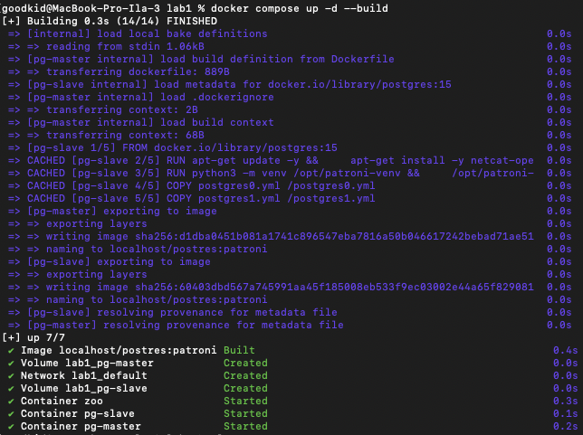

Команда docker ps показала, что все три контейнера перешли в состояние Up.

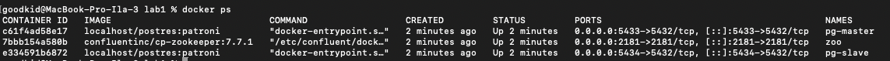

В выводе docker logs zoo видно, что ZooKeeper начал слушать порт 2181.

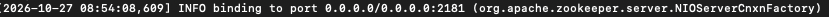

По логам Patroni проверили распределение ролей. Нода postgresql0 (pg-master) получила блокировку лидера, а postgresql1 (pg-slave) подключилась к ней как реплика.

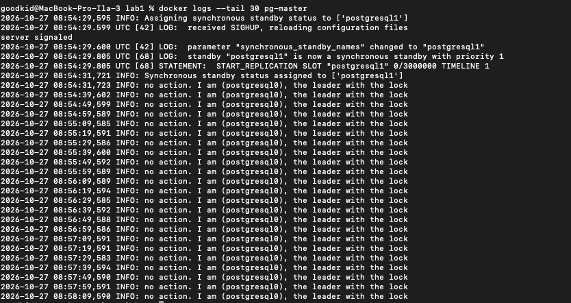

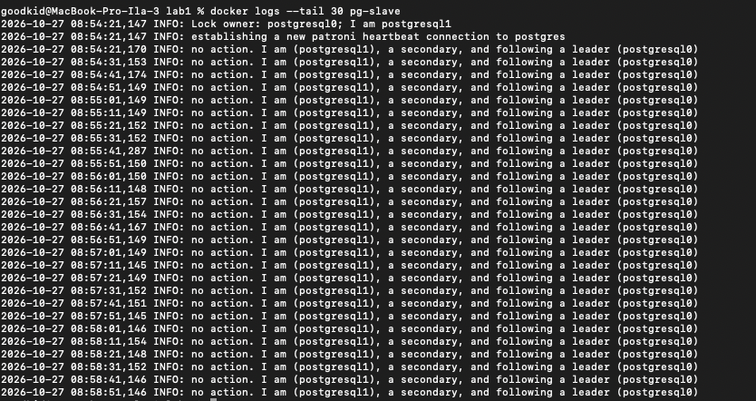

Состояние кластера подтвердили через patronictl.

```bash
docker exec pg-master patronictl -c /postgres0.yml list
```

Нода pg-master отображалась как Leader, а pg-slave как Sync Standby в состоянии streaming. В момент проверки отставание реплики было равно нулю.

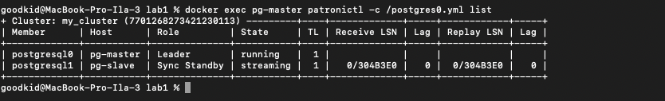

### 4. Ответы на дополнительные вопросы

Порты 8008 и 5432 вынесены в разные директивы, expose и ports. По сути, если записать 8008 в ports, то он тоже станет exposed. В чем разница?

expose объявляет порт внутри сети Docker. ports публикует порт контейнера на хосте.

При обычном перезапуске композ-проекта, будет ли сбилден заново образ? А если предварительно отредактировать файлы postgresX.yml? А если содержимое самого Dockerfile? Почему?

Нет. Даже после изменения postgresX.yml или Dockerfile обычный перезапуск использует уже собранный образ. Файлы postgresX.yml копируются в образ при сборке. Инструкции Dockerfile выполняются при сборке образа.

---

# Часть 2. Проверка репликации

### Шаг 1. Подключение к обеим нодам

В pgAdmin были созданы два подключения. Для обоих указали хост localhost, базу postgres, пользователя postgres и пароль postgres. Для pg-master использовали порт 5433, для pg-slave - 5434. В дереве pgAdmin открылась база postgres на обеих нодах.

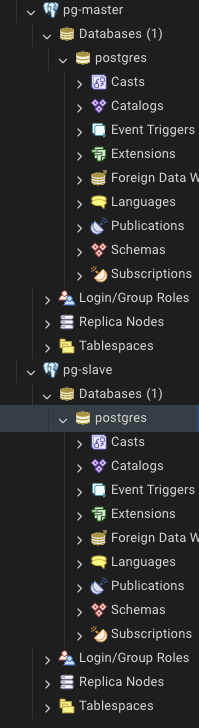

### Шаг 2. Создание таблицы и запись на лидере

По выводу patronictl лидером была нода pg-master. В её Query Tool создали таблицу my_first_replication и добавили одну строку.

```sql
CREATE TABLE my_first_replication (id int, my_data varchar, my_comment varchar);
INSERT INTO my_first_replication VALUES (1, 'my important data', 'is this line replicated?');
```

Сообщение INSERT 0 1 подтвердило, что строка была записана.

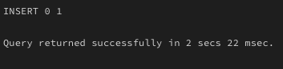

### Шаг 3. Чтение данных на реплике

В Query Tool ноды pg-slave выполнили запрос к той же таблице.

```sql
SELECT * FROM my_first_replication;
```

Запрос вернул строку с id = 1 и значением my important data. Таблица и запись появились на реплике автоматически через потоковую репликацию WAL.

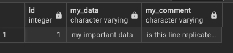

### Шаг 4. Проверка режима только для чтения

В том же подключении отдельно попытались вставить ещё одну строку и удалить таблицу.

```sql
INSERT INTO my_first_replication VALUES (2, 'new data', 'insert on replica');
DROP TABLE my_first_replication;
```

PostgreSQL отклонил обе команды с кодом 25006. В сообщениях указано, что INSERT и DROP TABLE нельзя выполнить в транзакции только для чтения. Проверка подтвердила, что реплика принимает запросы на чтение и отклоняет операции, меняющие данные или структуру таблицы.

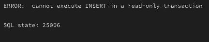

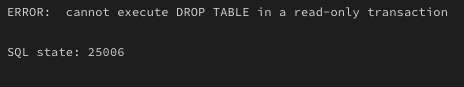

---

# Часть 3. HAProxy

### 1. Интеграция HAProxy в проект

В docker-compose.yml добавили сервис haproxy с конфигурацией из haproxy.cfg. Внутри сети Compose клиенты подключаются к postgres_entrypoint:5432. Страница статистики работает на порту 7000. HAProxy проверяет ноды через REST API Patroni на порту 8008. На запрос OPTIONS / Patroni отвечает кодом 200, если нода работает в роли primary и удерживает блокировку лидера. По результатам этих проверок HAProxy выбирает, куда направлять новые подключения.

С хоста используются localhost:5432 для PostgreSQL через HAProxy и http://localhost:7000/ для статистики. Если порты заняты, можно задать другие внешние порты при запуске. Например, при свободных 15432 и 17000 на macOS или Linux команда выглядит так.

```bash
HAPROXY_SQL_PORT=15432 HAPROXY_STATS_PORT=17000 docker compose up -d --build
```

### 2. Перезапуск и проверка состояния кластера

После внесения изменений проект перезапустили и проверили состояние контейнеров и логи.

```bash
docker compose down
docker compose up -d
docker compose ps
docker compose logs pg-master pg-slave haproxy
```

При контрольном запуске все четыре сервиса перешли в состояние Up. В логах Patroni обе ноды сообщили Zookeeper connection established, state: CONNECTED. HAProxy загрузил конфигурацию (Loading success), а проверка лидера вернула Layer7 check passed, code: 200. По выводу patronictl list нода pg-slave была лидером, а pg-master работала как синхронная реплика в состоянии streaming.

---

## Выполнение задания (Failover Test)

### Шаг 1. Определение текущего лидера

Определили текущего лидера запросом к каждой ноде.

```sql
SELECT pg_is_in_recovery();
```

- pg-master вернул t и работал как реплика.
- pg-slave вернул f и работал как лидер.

Перед остановкой повторили запрос через HAProxy.

```bash
docker compose exec pg-slave psql -h postgres_entrypoint -p 5432 -U postgres -d postgres -c "SELECT pg_is_in_recovery();"
```

Через postgres_entrypoint:5432 запрос вернул f. В статистике HAProxy нода pg-slave была в состоянии UP, а pg-master - DOWN для подключений через этот вход. При прямом подключении pg-master продолжал отвечать на запросы как реплика.

### Шаг 2. Принудительная остановка мастера

Остановили контейнер текущего лидера.

```powershell
docker compose stop pg-slave
```

После остановки pg-slave перестал принимать подключения.

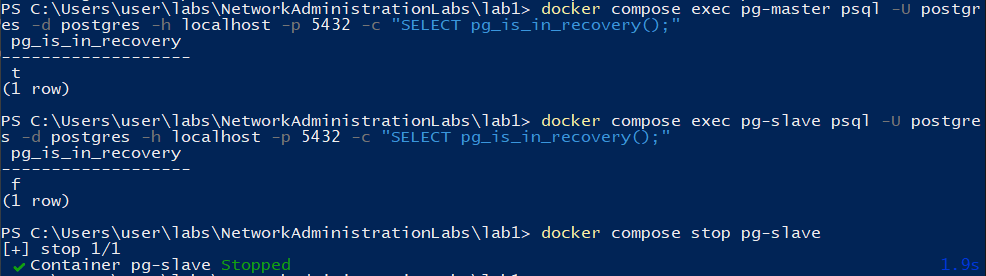

### Шаг 3. Анализ процесса Failover

После остановки лидера нода postgresql0 (pg-master) получила блокировку в ZooKeeper и повысила свою роль до primary. В логе видно получение запроса promote, переход PostgreSQL на новую timeline и готовность принимать подключения.

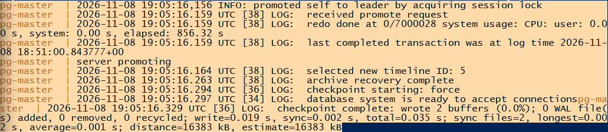

При контрольном запуске первая попытка подключения через HAProxy после остановки завершилась по тайм-ауту. Через 20 секунд от команды остановки прежний лидер отображался как DOWN, новый как UP, а клиент снова мог подключиться к тому же адресу.

### Шаг 4. Проверка работы через HAProxy

После завершения failover была проверена возможность подключения и записи через единую точку входа HAProxy (postgres_entrypoint:5432). Подключение выполнялось из живого контейнера:

```powershell
docker compose exec pg-master psql -h postgres_entrypoint -p 5432 -U postgres -d postgres
```

Внутри SQL-сессии были выполнены операции:

1. Проверка роли: SELECT pg_is_in_recovery(); - результат f, то есть HAProxy направила нас на активного мастера.
2. Создание тестовой таблицы ha_failover_test.
3. Вставка записи written_after_failover.
4. Чтение данных обратно.

После переключения HAProxy направил новое подключение на pg-master. На скриншоте видны успешные запись и чтение. В контрольном прогоне через тот же адрес прочитали и строку из my_first_replication, записанную до остановки лидера.

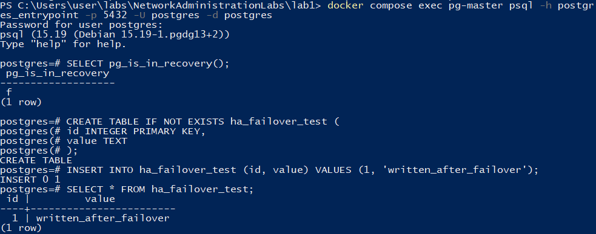

### Шаг 5. Возврат ноды и синхронизация данных

Остановленная ранее нода pg-slave была запущена обратно:

```powershell
docker compose start pg-slave
```

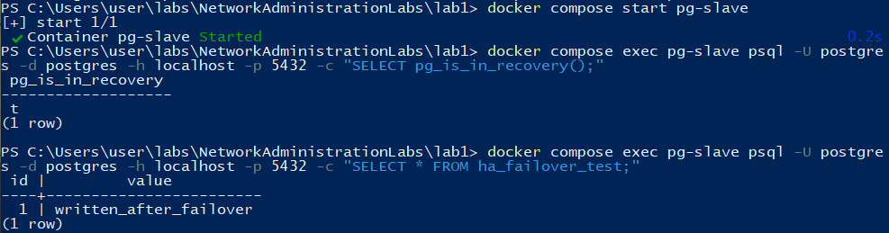

После запуска pg-slave присоединился к кластеру как реплика. Прямой запрос к этой ноде вернул t для pg_is_in_recovery(), а в таблице ha_failover_test появилась строка written_after_failover. Реплика получила через WAL данные, записанные на новом лидере во время её отсутствия. На контрольном запуске новый лидер также показал для вернувшейся ноды streaming и sync в pg_stat_replication.
