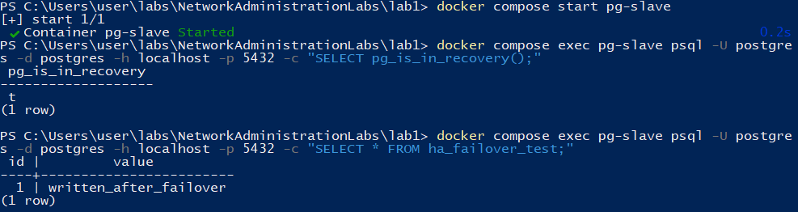

# Часть 3. High Availability с HAProxy

### 1. Интеграция HAProxy в проект

Для балансировки трафика был создан конфигурационный файл `haproxy.cfg` и добавлен новый сервис `haproxy` в `docker-compose.yml`. HAProxy слушает порт `5432` как основную точку входа и порт `7000` для страницы статистики. Проверка доступности нод выполняется через REST API Patroni (порт `8008`), поэтому балансировщик всегда знает, какая нода является текущим лидером, и направляет трафик именно на неё.

### 2. Перезапуск и проверка состояния кластера

После внесения изменений проект был перезапущен:

```bash
docker compose down
docker compose up -d
```

По итогам проверки все четыре контейнера (`pg-master`, `pg-slave`, `zoo`, `postgres_entrypoint`) перешли в состояние **Up**, а логи HAProxy не содержали ошибок конфигурации. Кластер готов к тесту отказоустойчивости.

---

## Выполнение задания (Failover Test)

### Шаг 1. Определение текущего лидера

Выясняем какая нода является мастером. Для этого в каждом контейнере выполнялся запрос статуса репликации:

```sql
SELECT pg_is_in_recovery();
```

Результаты:

- `pg-master` вернул `t` — нода является репликой.
- `pg-slave` вернул `f` — нода является мастером.

Значит, целью принудительной остановки выбрана нода **`pg-slave`**.



### Шаг 2. Принудительная остановка мастера

Мастер-нода была остановлена командой:

```powershell
docker compose stop pg-slave
```

Контейнер успешно завершил работу, что имитирует аварийный отказ сервера.


### Шаг 3. Анализ процесса Failover

Через несколько секунд после потери связи с лидером оставшаяся нода `pg-master` инициировала повышение собственного статуса. В логах Patroni видим:

1. Обнаружена недоступность старого лидера (`postgresql1`).
2. Нода `postgresql0` (`pg-master`) захватила блокировку в ZooKeeper.
3. Выполнена команда promote, PostgreSQL переведён в режим записи.
4. Система готова принимать соединения как новый мастер.

Ключевые строки из логов:

> `INFO: promoted self to leader by acquiring session lock`
> `LOG: database system is ready to accept connections`
> `INFO: no action. I am (postgresql0), the leader with the lock`


### Шаг 4. Проверка работы через HAProxy

После завершения failover была проверена возможность подключения и записи через единую точку входа HAProxy (`postgres_entrypoint:5432`). Подключение выполнялось из живого контейнера:

```powershell
docker compose exec pg-master psql -h postgres_entrypoint -p 5432 -U postgres -d postgres
```

Внутри SQL-сессии были выполнены операции:

1. Проверка роли: `SELECT pg_is_in_recovery();` — результат `f`, то есть HAProxy направила нас на активного мастера.
2. Создание тестовой таблицы `ha_failover_test`.
3. Вставка записи `written_after_failover`.
4. Чтение данных обратно.

Все операции прошли успешно. Это подтверждает, что HAProxy корректно перенаправила трафик на нового лидера (`pg-master`), несмотря на то, что прежний мастер был недоступен.


### Шаг 5. Возврат ноды и синхронизация данных

Остановленная ранее нода `pg-slave` была запущена обратно:

```powershell
docker compose start pg-slave
```


После присоединения к кластеру она автоматически определила, что лидер уже существует, и перешла в роль реплики. Данные, записанные на новом мастере во время её отсутствия, были получены через WAL-репликацию. Проверка через прямой запрос к `pg-slave` подтвердила наличие записи `written_after_failover`, то есть целостность данных сохранена.
