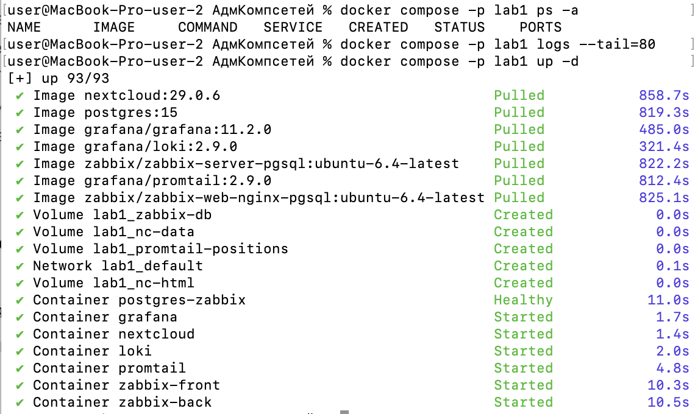
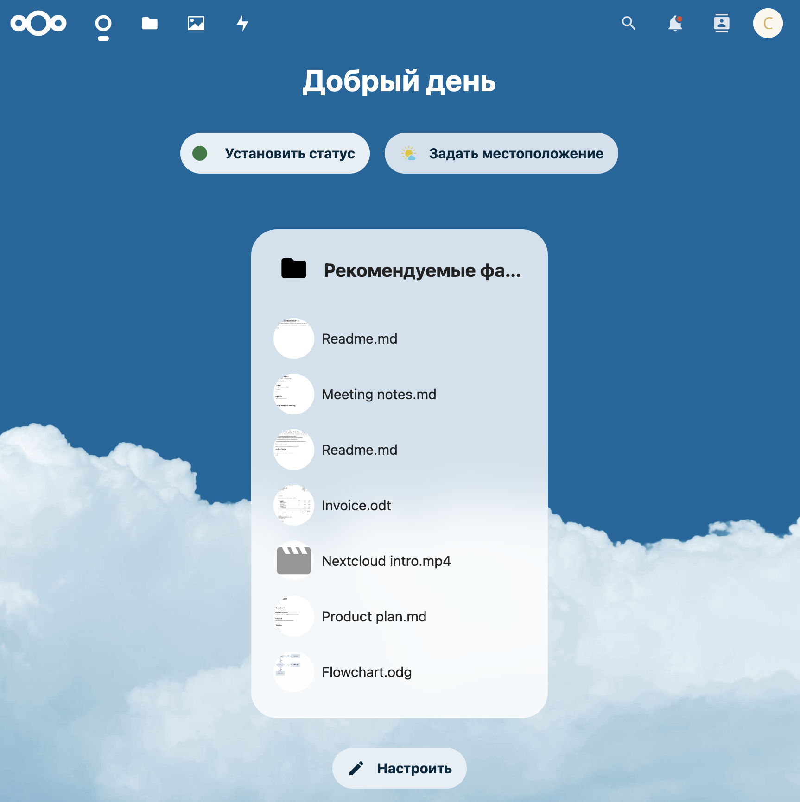
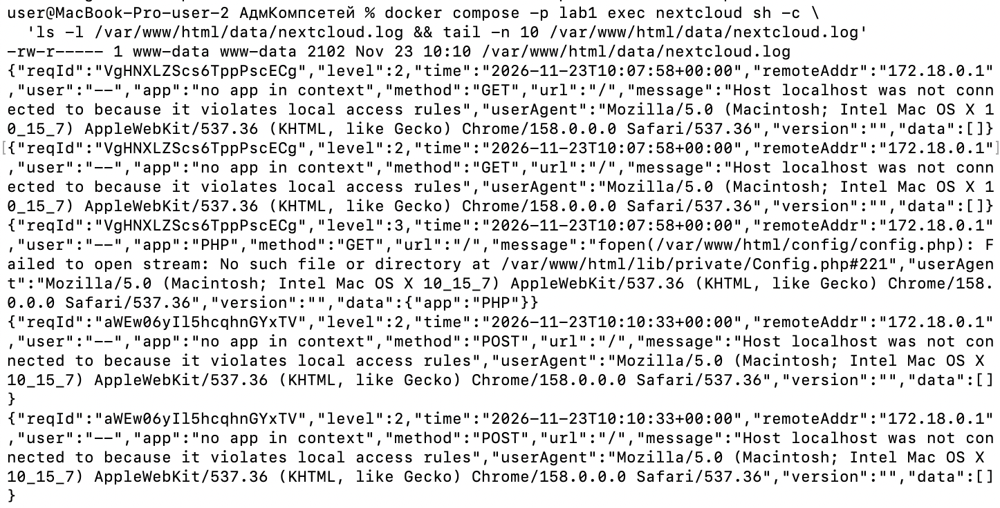
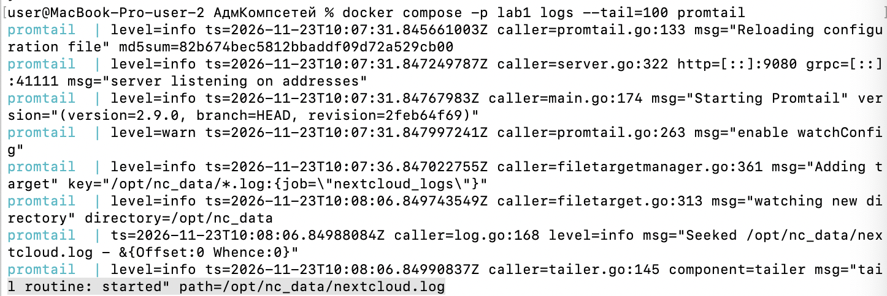

# Часть 1. Логирование Nextcloud

### 1. Подготовка стенда

В файле docker-compose.yml описали семь сервисов:

- nextcloud — тестовое приложение, события которого необходимо собирать;
- loki — сервис приёма и хранения логов;
- promtail — сборщик логов из файлов;
- grafana — сервис визуализации;
- postgres-zabbix — база данных Zabbix;
- zabbix-server — сервер мониторинга;
- zabbix-web-nginx-pgsql — веб-интерфейс Zabbix.
  
### 2. Настройка общего тома и Promtail

Для передачи файла логов между Nextcloud и Promtail использовали общий том nc-data. В контейнере Nextcloud он подключён к /var/www/html/data, а в контейнере Promtail — к /opt/nc_data. Файл /var/www/html/data/nextcloud.log в Nextcloud доступен сборщику по пути /opt/nc_data/nextcloud.log. В Promtail том подключен в режиме только для чтения.

В файле promtail_config.yml указали адрес Loki, путь к файлам логов и метку job:

```yaml
server:
  http_listen_port: 9080
  grpc_listen_port: 0

positions:
  filename: /var/lib/promtail/positions.yaml

clients:
  - url: http://loki:3100/loki/api/v1/push

scrape_configs:
  - job_name: nextcloud
    static_configs:
      - targets:
          - localhost
        labels:
          job: nextcloud_logs
          __path__: /opt/nc_data/*.log
```

Promtail читает файлы с расширением .log из каталога /opt/nc_data и настроен на отправку записей в Loki. Имя loki разрешается внутри сети Docker Compose. Метка job со значением nextcloud_logs позволяет выделять записи Nextcloud при последующем поиске. Файл positions.yaml хранит позиции чтения, для его сохранения выделен отдельный том promtail-positions.

### 3. Запуск контейнеров

Проверили конфигурацию и запустили сервисы:

```bash
docker compose -p lab1 config --quiet
docker compose -p lab1 up -d
```

При первом запуске Docker скачал необходимые образы, создал сеть и тома проекта. В выводе команды контейнеры получили статус Started, а PostgreSQL прошел проверку готовности и получил статус Healthy.



### 4. Первоначальная настройка Nextcloud

В браузере открыли http://localhost:8080 и выполнили первоначальную настройку Nextcloud с созданием учетной записи администратора. После установки и входа открылась главная страница приложения. Это подтвердило, что Nextcloud запущен и доступен через опубликованный порт 8080.



### 5. Проверка файла логов Nextcloud

В контейнере Nextcloud проверили наличие файла nextcloud.log и вывели последние десять строк:

```bash
docker compose -p lab1 exec nextcloud sh -c \
  'ls -l /var/www/html/data/nextcloud.log && tail -n 10 /var/www/html/data/nextcloud.log'
```

Команда показала, что файл существует и содержит записи в формате JSON. На скриншоте видны предупреждения и ошибка, зарегистрированные во время первоначальной настройки. Наличие этих записей подтверждает, что приложение записывает события в файл.



### 6. Проверка чтения логов через Promtail

Для проверки работы сборщика просмотрели журнал контейнера Promtail:

```bash
docker compose -p lab1 logs --tail=100 promtail
```

В журнале появились сообщения о добавлении источника /opt/nc_data/*.log с меткой job="nextcloud_logs" и начале наблюдения за каталогом /opt/nc_data. Сообщение Seeked /opt/nc_data/nextcloud.log подтвердило открытие файла и установку позиции чтения. Сообщение tail routine: started с тем же путем подтвердило запуск чтения файла и отслеживания новых записей.


